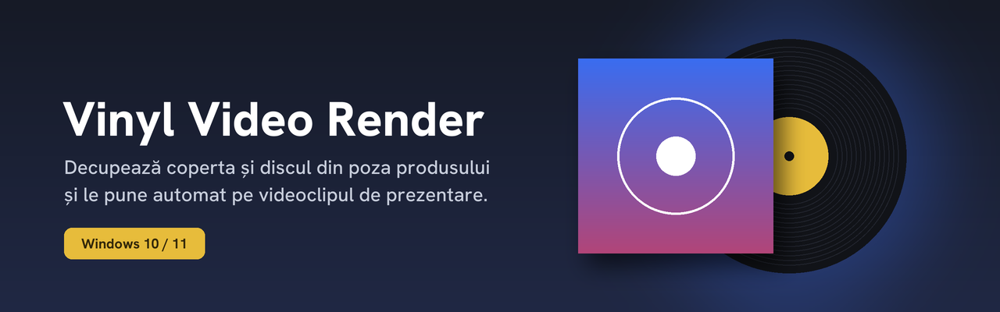
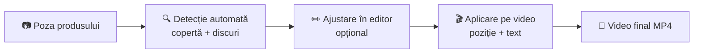

  

  
  
  

Aplicație desktop pentru magazinele de viniluri: încarci poza produsului (copertă + disc pe fundal de studio), programul decupează automat coperta și discurile și le animă peste videoclipul de prezentare al magazinului, împreună cu un bloc de text cu detaliile produsului.

## Cum funcționează

1. **Încarci poza** produsului. Ea apare neatinsă în editor.
2. **Alegi câte discuri** sunt în poză (1–4) și apeși **Detectează**.
3. **Verifici și ajustezi**, dacă e nevoie: colțurile copertei, cercurile discurilor, linia de separare.
4. **Alegi videoclipul-șablon**, poziția pe video și, opțional, textul cu detaliile produsului.
5. **Procesezi.** Rezultatul e un MP4 gata de publicat.

## Funcții

| | |
|---|---|
| 🔍 **Detecție automată** | Coperta și 1–4 discuri, inclusiv poze înclinate, coperți gatefold și discuri suprapuse. Funcționează și pe poze mici (screenshot-uri, imagini de pe site). |
| 🖼️ **Poza rămâne neatinsă** | Decupajul nu modifică niciun pixel. Marginile curate se obțin doar prin transparență, deci fără contur alb pe video. |
| ✏️ **Editor manual** | Colțurile copertei în mod dreptunghi sau perspectivă liberă, cercuri mutabile și redimensionabile, linie de separare disc / copertă. |
| 🎬 **Animație pe video** | Coperta și discurile intră împreună, ca un singur obiect, exact cum apar în poză. |
| 🎚️ **Poziție cu preview** | Muți rezultatul pe orizontală și verticală direct pe un cadru din video. |
| 🔤 **Text pe video** | Artist, album, variantă, piesă, dată, preț și etichetă (PRE-ORDER, ÎN STOC…), cu fade-in. Se poate muta, mări și colora. |
| 🖼️ **Aplicare șablon** | Un tab pentru pozele de produs: aplici o poză pe un șablon (față sau spate), cu logo opțional, și salvezi în **WebP**, JPEG sau PNG. WebP la calitate 90 e cu ~85% mai mic decât PNG, ideal pentru un site cu multe produse. |
| 🎵 **Conversie tracklist** | Al doilea tab: lipești un tracklist brut (de pe un site de discuri) și primești lista curată, fără timpi și cu artiștii invitați formatați ca „(Feat. A & B)”. |
| ⟳ **Actualizare dintr-un click** | Butonul **Actualizări** descarcă și instalează singur ultima versiune de aici. |

## Instalare

1. Deschide pagina **[Releases](https://github.com/H0dis/Vinyl-video-render/releases/latest)**.
2. Descarcă fișierul `.exe` din secțiunea *Assets*.
3. Pune-l într-un folder în care ai drept de scriere (de exemplu *Desktop* sau *Documente*, **nu** *Program Files*), ca actualizările să se poată instala.
4. Pornește-l. Nu necesită instalare sau alte programe.

> [!NOTE]
> Windows SmartScreen sau antivirusul pot avertiza la prima pornire, pentru că aplicația nu e semnată digital. Alege *Mai multe informații → Rulează oricum* sau adaugă o excepție pentru folderul aplicației.

## Actualizări

În aplicație, butonul **⟳ Actualizări** din colțul dreapta-sus verifică dacă există o versiune nouă aici. Dacă există, o descarcă, verifică integritatea fișierului, se închide, se înlocuiește și pornește din nou singură.

Istoricul complet al modificărilor e în **[CHANGELOG.md](CHANGELOG.md)**.

## Cerințe de sistem

- Windows 10 sau 11, 64-bit
- Ecran de minim 1280 × 720
- Conexiune la internet doar pentru actualizări

## Probleme frecvente

<b>Detecția găsește prea multe sau prea puține discuri</b>

Alege corect numărul de discuri înainte de **Detectează**. Dacă un disc e aproape complet ascuns în poză, mută-l manual în editor: trage de centrul cercului, apoi **Aplică și exportă**.

<b>Coperta e detectată puțin mai mică decât în realitate</b>

Se întâmplă la coperțile cu margine foarte deschisă pe fundal alb. Trage colțul copertei. Cu „Colțuri libere” debifat, chenarul rămâne dreptunghi.

<b>„Lipsește fontul HankenGrotesk.ttf”</b>

Exe-ul a fost compilat fără folderul `fonts`. Descarcă ultima versiune din Releases.

<b>Actualizarea nu se instalează</b>

Mută aplicația într-un folder în care ai drept de scriere (de exemplu *Desktop*) și verifică dacă antivirusul nu blochează fișierul descărcat.

---

  © 2026 Hodis Florin · Toate drepturile rezervate · <a href="LICENSE">Licență</a> · <a href="THIRD_PARTY_NOTICES.md">Componente terțe</a>

